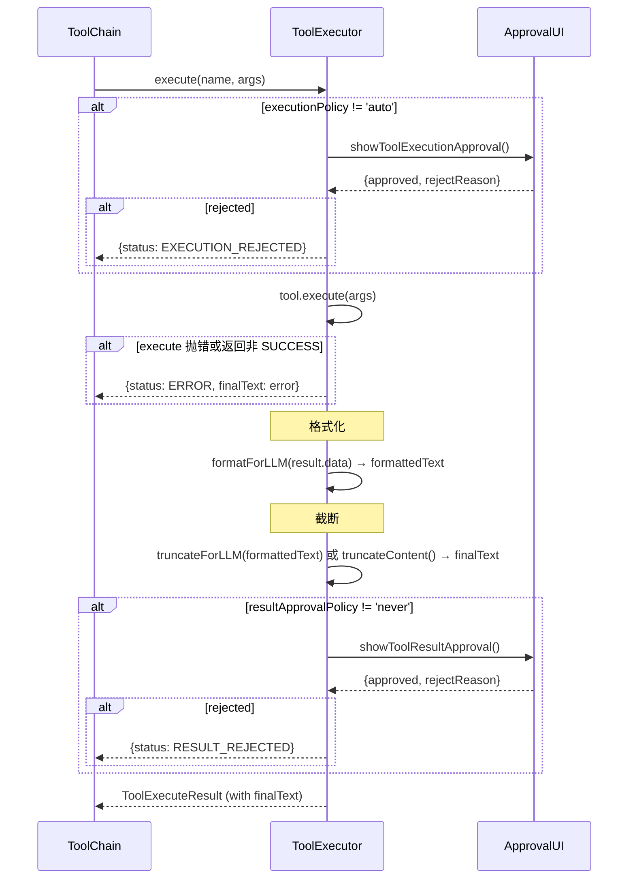

# ToolExecutor 与类型系统

## 类型系统

### Tool 接口（`types.ts`）

```typescript
interface Tool {
    definition:  IToolDefinition;          // OpenAI function spec
    permission:  ToolPermissionV2;         // 执行/结果审批策略
    execute:     (args) => Promise<ToolExecuteResult>;

    // 可选：自定义格式化/截断
    formatForLLM?:  (data, args) => string;
    truncateForLLM?: (formatted, args) => string;

    // 可选：控制标志
    SKIP_EXTERNAL_TRUNCATE?: boolean;      // true → 跳过截断
    DEFAULT_OUTPUT_LIMIT_CHAR?: number;    // 默认截断长度（覆盖全局默认值）
}
```

**关键字段说明**：
- `definition.function.name`：工具唯一标识，在 registry 中作为 key
- `formatForLLM`：将 `result.data` 转为 LLM 可读文本；未定义时用 `JSON.stringify`
- `truncateForLLM`：对 formatForLLM 的结果进行截断；未定义时用 `truncateContent()`（头尾保留，中间省略）
- `DEFAULT_OUTPUT_LIMIT_CHAR`：默认 `/src/func/gpt/tools/utils.ts` 中 `DEFAULT_LIMIT_CHAR`

### ToolGroup 接口（`types.ts`）

```typescript
interface ToolGroup {
    name: string;
    tools: Tool[];
    rulePrompt?: string | ((enabledToolNames: string[]) => string);
    declareSkillRules?: Record<string, {
        desc: string;         // 出现在规则索引表格中的简短描述
        prompt: string;       // 完整只读正文，通过 read-rule 读取
        when?: string;        // 何时使用
        alwaysLoad?: boolean; // true → 正文内联到 systemPrompt
    }>;
}
```

`rulePrompt` 支持函数形式，接收**当前已启用**的工具名列表，用于动态生成规则提示。

`declareSkillRules` 的正文不再进入变量系统，只由规则索引和 `read-rule` 消费，详见 [rules.md](./rules.md)。

### ToolExecuteResult（`types.ts`）

```typescript
interface ToolExecuteResult {
    status: ToolExecuteStatus;  // SUCCESS | ERROR | EXECUTION_REJECTED | RESULT_REJECTED | NOT_FOUND
    data?: any;                 // execute() 返回的原始数据
    error?: string;
    rejectReason?: string;

    // 由 ToolExecutor.execute() 填充
    formattedText?: string;     // data → formatForLLM()
    finalText?: string;         // formattedText → 截断
    isTruncated?: boolean;
    cacheFile?: string;         // 本地文件缓存（当前未启用）
}
```

`data → formattedText → finalText`：三阶段数据流，**最终发送给 LLM 的是 `finalText`**。结果没有任何变量或缓存引用字段。

---

## ToolExecutor 类

**位置**：`/src/func/gpt/tools/executor.ts`

### 内部状态

| 字段 | 类型 | 说明 |
|------|------|------|
| `registry` | `Record<string, Tool>` | name → Tool 映射（含内部工具 `read-rule`） |
| `groupRegistry` | `Record<string, ToolGroup>` | groupName → ToolGroup 映射 |
| `enablingStore` | `IStoreRef<{group, tool}>` | SolidJS 响应式 group/tool 启用状态 |
| `approvalRecords` | `Record<string, Decision>` | ask-once 策略的历史记录 |
| `executionApprovalCallback` | `UserApprovalCallback` | 执行前审批回调 |
| `resultApprovalCallback` | `ResultApprovalCallback` | 结果审批回调 |

工具执行器不持有会话级结果缓存或文档存储。

### 注册流程

```
constructor()
  └── registerTool(createReadRuleTool(() => Object.values(groupRegistry)))
         └── registry['read-rule'] = tool   // 不属于任何组，按需注入定义

registerToolGroup(group)
  ├── group.tools.forEach → registerTool(tool)
  │     └── registry[name] = tool
  │         enablingStore.update('tool', name, true)   // 工具默认启用
  ├── groupRegistry[group.name] = group
  └── enablingStore.update('group', name, false)       // 工具组默认禁用
```

`declareSkillRules` 无需注册：索引在 `toolRules()` 中直接由组定义生成，正文由 `read-rule` 在调用时查找。

**注意**：工具组注册后默认**禁用**。需通过 `toggleGroupEnabled(name, true)` 或 `toolExecutorFactory` 中的 `groupDefaults` 启用。

### enabled 状态 API

```typescript
isGroupEnabled(name: string): boolean
toggleGroupEnabled(name: string, enabled?: boolean): void
isToolEnabled(name: string): boolean
setToolEnabled(name: string, enabled: boolean): void
getEnabledToolDefinitions(): IToolDefinition[]  // 供 LLM API 使用，可能附加 read-rule
```

`getEnabledToolDefinitions()`：按启用状态收集工具定义后，若存在“已启用组 + 该组有启用工具 + 该组有 `alwaysLoad` 为假的规则”，追加 `read-rule` 定义。触发条件与原因见 [rules.md](./rules.md)。

**启用状态只决定提供给模型的定义**。`execute()` 按名称查 `registry`，不检查组或工具是否启用，这是刻意保留的语义，不是待修缺陷。

### toolRules() 生成 System Prompt

```
toolRules()
  ├── 基础规范（审批提示、limit 截断说明、read-rule 使用提示）
  └── 对每个 enabled group:
        resolveGroupRulePrompt(groupName)
          ├── 调用 rulePrompt（字符串或函数）——可为空
          └── 拼接 generateSkillRuleIndex()（alwaysLoad 直接内联 / 其余生成表格）
        两者都为空才跳过该组
```

---

## execute() 执行流



### 截断逻辑细节

1. `SKIP_EXTERNAL_TRUNCATE = true` → 跳过所有截断（`read-rule` 使用此标志返回完整正文）
2. `tool.truncateForLLM` 存在 → 使用工具自定义截断（可读取 `args.limit` / `args.begin`）
3. 否则使用 `truncateContent(formatted, limit)`（默认头尾各保留部分，中间省略）
4. `args.limit = 0 或 -1` → 不截断（发送完整内容）

截断只是本次发给模型的内容变短；完整 `formattedText` 保留在返回值里供调用方使用，不会另存为可再读取的变量。

---

## toolExecutorFactory（`index.ts`）

工厂函数，每个 ChatSession 调用一次：

```typescript
toolExecutorFactory({ approvalAdapter? })
  1. new ToolExecutor()                           // 创建实例（内部已注册 read-rule）
  2. registerToolGroup(basicTool)
  3. registerToolGroup(toolGroupWeb)
  4. registerToolGroup(createFileSystemToolGroup())
  5. IS_IN_APP && registerToolGroup(scriptTools)   // 仅桌面端
  6. registerToolGroup(siyuanTool)
  7. IS_IN_APP:
       createCustomScriptToolGroupsFromCache()
       → 对每组调用 registerToolGroup()
       → 如果 groupDefaults 有记录，应用启用状态
  8. 绑定 executionApprovalCallback               // 代理到 approvalAdapter
  9. 绑定 resultApprovalCallback                  // 代理到 approvalAdapter
  10. 应用 toolsManager().groupDefaults → toggleGroupEnabled
  11. 应用 toolsManager().toolDefaults → setToolEnabled
  return toolExecutor
```

**集成点**（`use-chat-session.ts`）：

```typescript
const pendingApprovals = useStoreRef<PendingApproval[]>([]);
const inlineApprovalAdapter = new InlineApprovalAdapter(pendingApprovals, newID);
const toolExecutor = toolExecutorFactory({ approvalAdapter: inlineApprovalAdapter });
```

每个 ChatSession 独立拥有一个 `ToolExecutor` 实例。实例之间不共享启用状态，也不共享规则或结果缓存。
