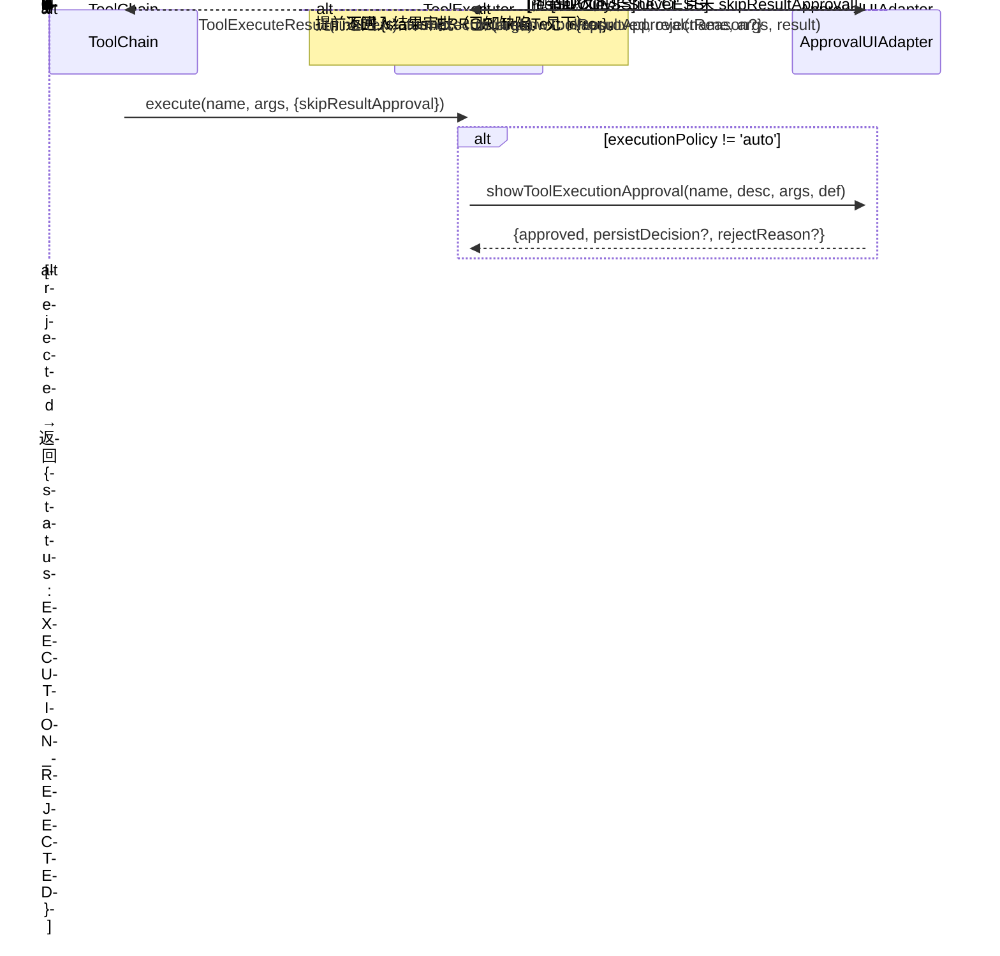

# ToolExecutor 与执行/审批流

接口定义在 `src/func/gpt/tools/types.ts`（`Tool` / `ToolGroup` / `ToolExecuteResult` / `ToolPermissionV2` / `ApprovalUIAdapter` / `PendingApproval`），本文不复抄，只记录代码表面读不出的语义与流转。

## 数据流三阶段

```
result.data  →  formatForLLM() → formattedText  →  截断 → finalText
```

最终发给 LLM 的只有 `finalText`。`formattedText` 只存在于本次调用的返回值里；审批 UI 与 `toolChainResult` 都只保留 `finalText`，所以被截断的部分没有变量、缓存或文件可以取回。

`formatForLLM` 未定义时用 `JSON.stringify`；`truncateForLLM` 未定义时用全局 `truncateContent()`（`utils.ts`，只保留开头）。

### 截断决策顺序

1. `SKIP_EXTERNAL_TRUNCATE = true` → 不截断（`read-rule` 正文完整返回）；
2. 工具自定义 `truncateForLLM` → 优先，由工具自己解释 `args.limit` / `args.begin`。脚本组用 `truncateMiddle()` 保留首尾（否则先丢 stderr）；`FetchWebPage`/`ExtractHTML`/Tavily/Bocha 使用各自的字符或分页逻辑；
3. 否则上限取 `DEFAULT_OUTPUT_LIMIT_CHAR || DEFAULT_LIMIT_CHAR`（32K），`truncateContent()` 只保留开头；
4. `limit` 不是隐藏通用参数：只有工具 schema 声明了 `limit`，`args.limit` 才作为字符上限生效（0 或负数 = 不限）；未声明时它只是普通入参。

## ToolExecutor 内部状态

| 字段 | 说明 |
|------|------|
| `registry` | name → Tool（含内部工具 `read-rule`） |
| `groupRegistry` | groupName → ToolGroup |
| `enablingStore` | 响应式 group/tool 启用状态 |
| `approvalRecords` | ask-once 决策记录（key = toolName + args hash） |
| 两个审批回调 | 分别代理到 ApprovalUIAdapter 的执行前/结果审批 |

工具执行器不持有会话级结果缓存或文档存储。

## 注册与启用语义

```
constructor          → 注册内部工具 read-rule
registerToolGroup    → 逐个注册组内工具 + 收录组定义
                       组默认禁用；组内工具以 group.defaultToolEnabled ?? true 为初始选中
toolExecutorFactory  → 按 toolsManager().groupDefaults / toolDefaults 应用用户设置
```

两条刻意保留的语义（不是待修缺陷）：

- **启用状态只决定提供给模型的定义**。`execute()` 按名称查 `registry`，不校验组/工具是否启用——"工具开关仅过滤定义，按名仍可执行"。
- `declareSkillRules` 不需要注册动作：索引在 `toolRules()` 由组定义直接生成，正文由 `read-rule` 调用时查找。

`getEnabledToolDefinitions()` 收集启用定义后，若存在"已启用组 + 组内有启用工具 + 组有 `alwaysLoad` 为假的规则"，追加注入 `read-rule` 定义。理由见 [rules.md](./rules.md)。

`toolRules()` 生成 system prompt 片段：每个已启用组 = 其 `rulePrompt`（字符串或接收启用工具名的函数）+ 该组规则索引渲染；两者都为空才跳过。

## execute() 全流



**审批策略**（`getEffectivePermissionConfig()`：`override > tool.permission`）：

| executionPolicy | 行为 |
|---|---|
| `auto` | 不询问 |
| `ask-once` | 首次询问，按 `generateApprovalKey(name, args)` 缓存决策记录 |
| `ask-always` | 每次询问 |

| resultApprovalPolicy | 行为 |
|---|---|
| `never` | 直接发送 |
| `on-error` | **ERROR → 审批**；SUCCESS 直接发送（但对错误结果当前到不了审批，见"已知缺陷"） |
| `always` | 先审批后发送 |

旧格式 `ToolPermission`（permissionLevel/requireExecutionApproval/requireResultApproval）仍向后兼容，映射在 `getEffectivePermissionConfig()` 内；用户运行时覆盖写 `toolsManager().toolPermissionOverrides[toolName]`。

## 权限审批 UI

`ApprovalUIAdapter` 有两个实现（`approval-ui.tsx`），输入输出合同一致（`Promise<{approved, rejectReason}>`，执行审批多一个 `persistDecision`）：

- **DefaultUIAdapter**：`solidDialog` 阻塞弹窗，用于非 Chat 或回退场景；高危工具走 `toolCallSafetyReview()` 附加警告。
- **InlineApprovalAdapter**：ChatSession 内联卡片。`showToolXxxApproval()` 返回不 resolve 的 Promise，把带 `resolve` 引用的 `PendingApproval` 推入 `pendingApprovals` store；UI 渲染卡片，用户操作后调用 `item.resolve()` 放行。Promise 不与停止信号联动（放弃等待需结合 [停止行为](./toolchain.md)）。

## 已知缺陷（登记在 .dev/issues/ 的路径）

**错误结果绕过结果审批**：`execute()` 对非 SUCCESS 提前返回，`on-error` 配置实际不会对错误结果触发审批；抛异常路径同样不进入审批。分析与修复边界见 [.dev/issues/26-10-31_gpt-error-result-approval.md](../../issues/26-10-31_gpt-error-result-approval.md)。

## toolExecutorFactory（`index.ts`）

每个 ChatSession 调用一次，实例间不共享启用状态/审批记录/规则：

```
toolExecutorFactory({ approvalAdapter? })
  1–6. 注册 basic / web / file-system / script(仅桌面) / siyuan 各组
  7.   IS_IN_APP: createCustomScriptToolGroupsFromCache() 注册自定义工具组
  8–9. executionApprovalCallback / resultApprovalCallback 代理到 approvalAdapter
  10–11. 应用 toolsManager().groupDefaults → toggleGroupEnabled
         应用 toolsManager().toolDefaults → setToolEnabled
```

Chat 集成侧（`use-chat-session.ts`）每会话创建一个 `InlineApprovalAdapter` + 一个 executor。

自定义脚本组的解析与加载机制见 [custom-tools.md](./custom-tools.md)；工具循环在 [toolchain.md](./toolchain.md)。
