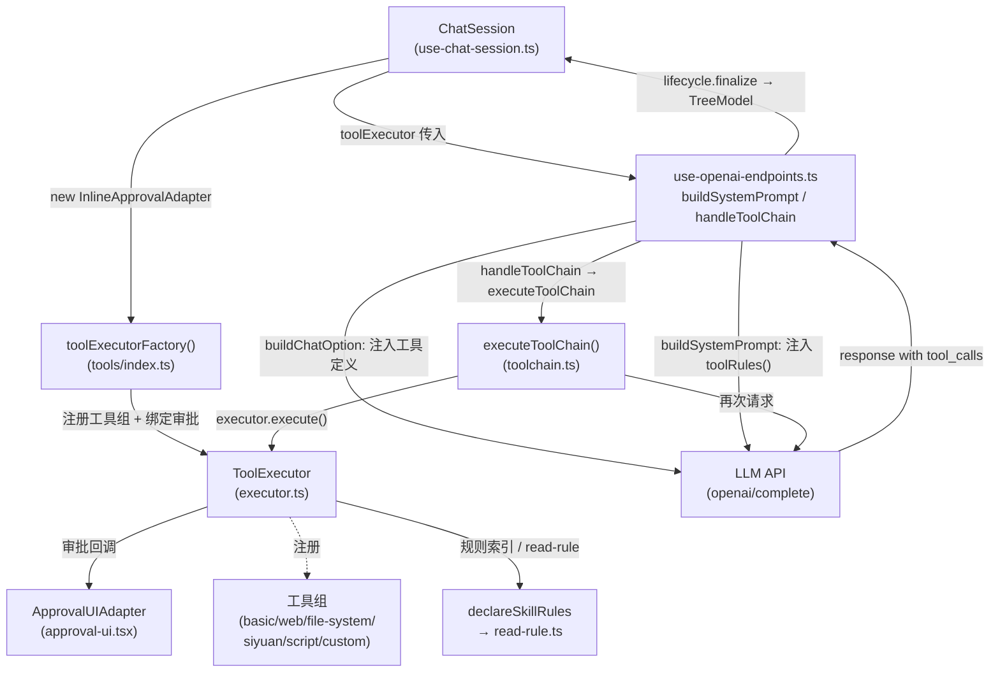

# Tool Call 机制

## 导航

| 文档 | 内容 |
|------|------|
| [executor.md](./executor.md) | ToolExecutor 注册、execute() 全流、权限/审批模型与 UI、截断、工厂初始化 |
| [toolchain.md](./toolchain.md) | LLM↔工具对话循环、原生工具消息结构、结束状态 | |
| [rules.md](./rules.md) | 只读规则文档：声明、索引、`read-rule` 与查找范围 |
| [custom-tools.md](./custom-tools.md) | 自定义脚本工具（Python/PowerShell）解析与加载 |
| [integration.md](./integration.md) | Chat 集成层：注入、systemPrompt、执行链路、结果持久化 |

---

## 整体架构

---

## 一轮完整发送的级际顺序

`ChatSession.sendMessage()` → `useGptCommunication.sendMessage()`（先取历史再插占位）→ `buildSystemPrompt / buildChatOption` → 首次 `complete()` → 返回含 `tool_calls` 时 `handleToolChain()` 进入工具循环 → `toolChainToCompletion()` 转持久化形态 → `lifecycle.finalize()` 写入本次占位版本。

循环与消息结构见 [toolchain.md](./toolchain.md)；集成层流程、回放判定与持久化形态见 [integration.md](./integration.md)。

---

## 工具组汇总

| 工具组名 | 主要工具 | 特殊机制 |
|---------|---------|---------|
| `basic-tools` | datetime、text | — |
| `网页检索工具组` | BingSearch、GoogleSearch、TavilySearch、BochaSearch、FetchWebPage、SearchInWebPage、ExtractHTML、InspectDOMStructure | Google 总可用（无 key 时抓取）；Tavily/Bocha 需对应 API key |
| `文件系统工具组` | fs-View、fs-SearchReplace、fs-WriteFile | 仅桌面端（Node 可用时才有工具） |
| `siyuan-tools` | listNotebooks、navigateDocTree、listActiveDocs、getDailyNoteDocs、getBlockInfo、getBlockContent、appendContent、createNewDoc、applyBlockDiff、searchDocument、querySQL、searchKeyword | 领域规则与自定义 diff/slice 语法见 [rules.md](./rules.md) |
| `思源原生 MCP` | 官方暴露且 Schema 可表示的工具，模型名为 `sy_mcp_<原名>` | GPT 启动快照；默认全不选；同源通信及组件生命周期边界见 [integration.md](./integration.md#原生-mcp-的启动边界)；不进入 Tool Hub |
| `脚本执行工具组` | Shell、Python、JavaScript | 仅桌面端 (`IS_IN_APP`) |
| 自定义工具组 | 由 `.tool.json` 描述，Python/PowerShell 执行 | 见 [custom-tools.md](./custom-tools.md) |
| `read-rule`（非组） | 按 `Rule/<group>/<name>` 读取规则正文 | 内部辅助工具，按需自动注入定义 |

> **不在本文档覆盖范围**：
> - 各工具组内部实现细节（如 Bing API 调用、DiffEdit 差异算法）
> - 工具执行逻辑之外的聊天树与版本机制（见 [integration.md](./integration.md) 与持久化文档）
