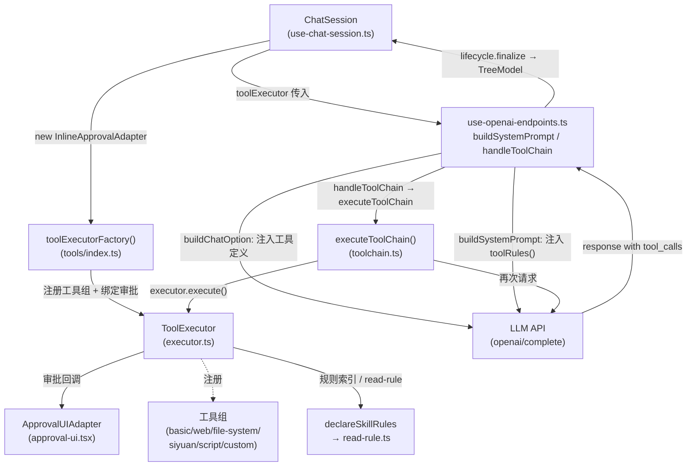

# Tool Call 机制

## 导航

| 文档 | 内容 |
|------|------|
| [executor.md](./executor.md) | 类型系统、ToolExecutor 注册与执行核心 |
| [toolchain.md](./toolchain.md) | LLM↔工具对话循环、原生工具消息结构、结束状态 |
| [approval.md](./approval.md) | 权限模型、审批 UI 适配器 |
| [rules.md](./rules.md) | 只读规则文档：声明、索引、`read-rule` 与查找范围 |
| [custom-tools.md](./custom-tools.md) | 自定义脚本工具（Python/PowerShell）解析与加载 |
| [integration.md](./integration.md) | Chat 集成层：注入、systemPrompt、执行链路、结果持久化 |

---

## 整体架构



---

## 工具调用全链路（简版序列）

```
用户发送消息
  ↓
ChatSession.sendMessage()  [use-chat-session.ts]
  ↓
useGptCommunication.sendMessage()  [use-openai-endpoints.ts]
  ├── getAttachedHistory()          ← 在创建占位前获取（避免占位污染历史）
  ├── lifecycle.prepareSlot()       ← TreeModel 插入 loading 占位
  └── executeChatRequest()
        ├── buildSystemPrompt()     ← 用户 prompt + toolRules()（工具规则 + 规则索引）
        ├── buildChatOption()       ← 注入 tools + tool_choice='auto'
        ├── gpt.complete(messages)  ← 第一次 LLM 请求
        └── if response.tool_calls → handleToolChain()
              └── executeToolChain(executor, response, options)  [toolchain.ts]
                    [循环] for each tool_call:
                      executor.execute(name, args)   [executor.ts]
                      → checkExecutionApproval() → 可能弹审批 UI
                      → tool.execute(args)
                      → format → truncate（SKIP_EXTERNAL_TRUNCATE 可跳过）
                      → checkResultApproval() → 可能弹审批 UI
                      → 构建 {role:'tool', content: finalText}
                    重新调用 LLM... 直到无 tool_calls 或达 maxRounds
                    停止条件触发时追加一条 [SYSTEM] user 提示再请求最终回复
  ↓
toolChainToCompletion()  ← 末条 assistant 拆为回答正文，其余原生消息进 toolChainMessages
  ↓
lifecycle.finalize()  ← 写入 message + toolChainMessages + toolChainResult 到本次占位版本
  ↓
TreeModel 更新 → UI 响应式刷新
```

持久化形态（原生消息，无压缩日志、无结果变量）见 [integration.md](./integration.md)；失败与中断的收尾行为同样记录在那里。

---

## 工具组汇总

| 工具组名 | 主要工具 | 特殊机制 |
|---------|---------|---------|
| `basic-tools` | datetime、text | — |
| `网页检索工具组` | BingSearch、GoogleSearch、TavilySearch、BochaSearch、FetchWebPage、SearchInWebPage、ExtractHTML、InspectDOMStructure | Google 总可用（无 key 时抓取）；Tavily/Bocha 需对应 API key |
| `文件系统工具组` | fs-View、fs-SearchReplace、fs-WriteFile | 仅桌面端（Node 可用时才有工具） |
| `siyuan-tools` | listNotebooks、navigateDocTree、listActiveDocs、getDailyNoteDocs、getBlockInfo、getBlockContent、appendContent、createNewDoc、applyBlockDiff、searchDocument、querySQL、searchKeyword | 领域规则与自定义 diff/slice 语法见 [rules.md](./rules.md) |
| `脚本执行工具组` | Shell、Python、JavaScript | 仅桌面端 (`IS_IN_APP`) |
| 自定义工具组 | 由 `.tool.json` 描述，Python/PowerShell 执行 | 见 [custom-tools.md](./custom-tools.md) |
| `read-rule`（非组） | 按 `Rule/<group>/<name>` 读取规则正文 | 内部辅助工具，按需自动注入定义 |

> **不在本文档覆盖范围**：
> - 各工具组内部实现细节（如 Bing API 调用、DiffEdit 差异算法）
> - 工具执行逻辑之外的聊天树与版本机制（见 [integration.md](./integration.md) 与持久化文档）
